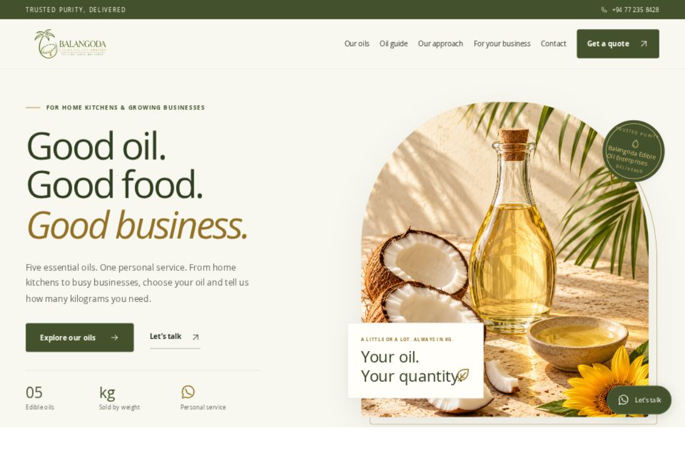

# 🌿 Balangoda Edible Oil Enterprises (BEO): Wholesale Edible Oil Web Portal

Welcome to the official repository for **Balangoda Edible Oil Enterprises (BEO)** — **S&S Oil Distributors**!

🚀 **Balangoda Edible Oil Enterprises (BEO)** is a completed, responsive B2B wholesale web storefront and landing page created as my **first-ever web development project**. Designed around a warm, editorial olive-and-cream brand identity, the platform showcases **The Balangoda Collection** of five pure edible oils sold by the kilogram, comprehensive technical oil specifications, flexible bulk supply options, and direct leadership inquiry channels deployed on Vercel.

## 📌 Project Overview

The goal of this project is to design, prototype, and deploy a clean commercial B2B web interface for a wholesale edible oil distribution enterprise in Balangoda while practicing core frontend development and cloud deployment workflows.

- **Brand:** Balangoda Edible Oil Enterprises (BEO) / S&S Oil Distributors
- **Project Type:** First Web Development Project (Commercial B2B Wholesale Portal)
- **Developer:** Sadew Kulathunga (@kulathungasadew15)
- **Leadership:** Sumith Kulathunga (Founder) & Mr. Nalinda (Managing Director)
- **Hosting Platform:** Vercel Cloud (Production Environment)
- **Current Status:** ✅ **Project Completed & Deployed.** All landing page layouts, transparent brand assets, technical oil guides, responsive styles, and production domain routes are live.

## 🎯 Core Objectives & Features

The **BEO Wholesale Portal** is engineered to deliver the following frontend and commercial B2B features:

- 🎨 **Editorial Brand Storytelling:** Establish an authentic, trustworthy wholesale presence around the promises *"Trusted Purity, Delivered."* and *"Good products. A personal connection."*
- 🫒 **The Balangoda Collection (05 Edible Oils):** Showcase five core wholesale oil varieties—**Pure Coconut Oil**, **Palm Oil**, **Sunflower Oil**, **RBD Coconut Oil**, and **Canola Oil**.
- ⚖️ **Sold by the Kilogram:** Highlight flexible weight-based wholesale supply capabilities tailored to commercial buyers (*"Every oil is sold by the kilogram"*).
- 📖 **Technical Oil Specifications Hub:** Educate retail, food-service, and industrial buyers with dedicated descriptions covering extraction grades, smoke points, health profiles, and culinary uses for each oil.
- 🤝 **Direct Leadership Connection:** Connect buyers directly with Founder **Sumith Kulathunga** and Managing Director **Mr. Nalinda** (+94 76 062 8331) via quick-access phone and WhatsApp triggers (*"Let's talk"*).
- 📱 **Responsive Layout Architecture:** Adapt smoothly across desktop, tablet, and mobile viewports using clean semantic HTML5 and modern CSS Flexbox/Grid layouts.
- ⚡ **Edge Cloud Deployment:** Serve static assets and high-resolution product visuals globally with sub-second load times via Vercel's production network.

⚠️ **Project Note:** This repository serves both as the official commercial web presence for **Balangoda Edible Oil Enterprises** and as a foundational frontend engineering portfolio project built to practice modern UI/UX design, responsive styling, and cloud hosting workflows.

## 🌐 Live Web Portal

The platform is deployed and hosted live on Vercel's production edge network. Visitors accessing the public web portal can explore:

- **Primary Production URL:** [https://balangodaoil.vercel.app/](https://balangodaoil.vercel.app/)
- **Legacy Alias URL:** [https://sscocovercel.vercel.app/](https://sscocovercel.vercel.app/)
- **Hero & Botanical Arch Showcase:** High-impact editorial typography paired with natural edible oil visuals, botanical arch framing, and purity badges.
- **B2B Inquiry Flow:** Direct WhatsApp and telephone contact triggers for commercial quotes and sealed lorry bulk supply.

The main entry file is located in the root of the repository under [index.html](index.html).

## ⚙️ User & Business Workflow

The landing page guides prospective wholesale buyers through a streamlined 4-step purchasing journey:

1. **Brand Introduction:** Visitors land on the hero showcase featuring BEO's purity guarantee, Balangoda heritage, and core wholesale value proposition.
2. **Collection Exploration:** Buyers browse **The Balangoda Collection** featuring Pure Coconut Oil, Palm Oil, Sunflower Oil, RBD Coconut Oil, and Canola Oil sold by the kilogram (kg).
3. **Technical Comparison:** Commercial clients review the dedicated oil knowledge section to compare smoke points, purity grades, and culinary/industrial applications alongside sealed lorry delivery options.
4. **Direct Engagement:** Prospective buyers click the interactive call-to-action buttons to speak directly with **Sumith Kulathunga** (Founder) or **Mr. Nalinda** (Managing Director) for custom volume quotes and order fulfillment.

## 🛠️ Tech Stack & Architecture

The project uses a clean, dependency-free frontend architecture connected directly to Vercel for automated cloud builds and custom domain routing.

| Technology / Tool | Intended Purpose |
| :--- | :--- |
| **HTML5** | Semantic document structure, accessibility landmarks, and multi-section layout |
| **CSS3** | Custom olive-and-cream editorial palette, arch cards, typography, and responsive grid |
| **JavaScript** | Interactive UI behaviors, smooth scroll navigation, and direct WhatsApp CTA routing |
| **Git & GitHub** | Version control, asset management, and source code repository hosting |
| **Vercel** | Production cloud hosting, SSL provisioning, and custom domain routing |

## 📈 Final Project Implementation Status

| Subsystem / Area | Status |
| :--- | :--- |
| **Transparent Brand Logo & Navigation Bar** | ✅ Tested and fully responsive |
| **Hero Showcase & Botanical BEO Arch** | ✅ Layout and editorial visual styling verified |
| **The Balangoda Collection Bar (05 Edible Oils)** | ✅ Single-row responsive layout integrated |
| **Technical Oil Specifications Section** | ✅ Detailed profiles added for all 5 oils |
| **Leadership Directory & WhatsApp CTAs** | ✅ Founder & Managing Director contacts linked |
| **Vercel Production Deployment** | ✅ Live at https://balangodaoil.vercel.app/ |

## 📂 Project Documentation & Assets

Repository source files and visual assets are organized as follows:

| Path / File | Description |
| :--- | :--- |
| 🌐 **[index.html](index.html)** | Main landing page entry point and semantic markup |
| 🎨 **css/** | Stylesheets for layout grids, olive-and-cream theme, and responsive breakpoints |
| 💻 **js/** | Frontend scripts for interactive page elements and inquiry triggers |
| 🖼️ **assets/** | Transparent brand logos, edible oil photography, and UI icons |
| 📄 **[README.md](README.md)** | Project documentation, architecture overview, and live links |

## 🖥️ Live Preview & Interface Design

🔗 **Live Production Website:** [Visit Balangoda Edible Oil Enterprises on Vercel](https://balangodaoil.vercel.app/)

## 👨‍💻 Project Developer & Leadership

| Name | Role & Contact |
| :--- | :--- |
| **SADEW KULATHUNGA** (@kulathungasadew15) | ⭐ UI/UX Design, Frontend Development & Cloud Deployment |
| **SUMITH KULATHUNGA** | 🏢 Founder — Balangoda Edible Oil Enterprises |
| **MR. NALINDA** | 📞 Managing Director — +94 76 062 8331 |

## 🗺️ Completed Milestones

- [x] Establish the **Balangoda Edible Oil Enterprises (BEO)** olive, gold, and warm-cream editorial brand identity.
- [x] Integrate the clean transparent header logo and responsive navigation bar.
- [x] Expand **The Balangoda Collection** to 5 wholesale edible oils: Pure Coconut, Palm, Sunflower, RBD Coconut, and Canola oil.
- [x] Build a dedicated technical specifications section detailing the properties and uses of each oil variety.
- [x] Add direct executive contact channels for Founder **Sumith Kulathunga** and Managing Director **Mr. Nalinda**.
- [x] Deploy the production build to Vercel and configure routing under https://balangodaoil.vercel.app/.
